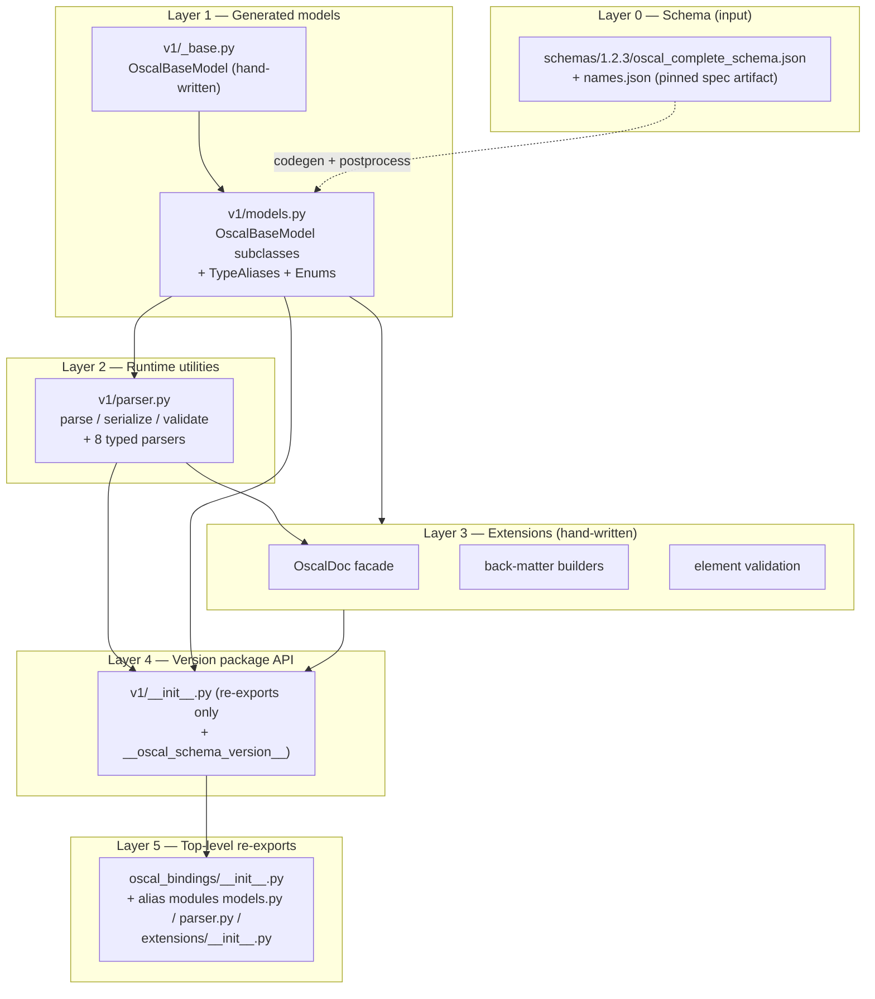
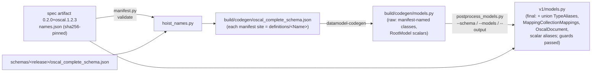

# Architecture

## System Purpose

`oscal-bindings` is a **data-binding library**, not a service or application. It targets OSCAL release 1.2.3. Its job is to turn OSCAL JSON documents into type-safe Python objects and back again, with convenience layers that make common tasks (uniform field access, building `back-matter` resources, validating fragments) ergonomic.

There is no network server, no persistence layer, and no long-running process. The architecture is best understood as **two pipelines**: a *build-time code-generation pipeline* that produces the models, and a *runtime consumption pipeline* that downstream code uses.

## Layered Architecture

Each layer depends only on layers below it. Extensions depend on `v1/models.py` (and `v1/parser.py` for `OscalDoc.from_json/from_file`), never the reverse. Layers 4 and 5 are both pure re-export: layer 4 is the API of record, layer 5 exists only to keep the pre-`v1` flat import paths resolving.

## Version Namespacing

The binding namespace is scoped to the OSCAL **major** version, not the minor. OSCAL 1.x is backward-compatible within its major version, and NIST's own schema `$id` reflects that split — `http://csrc.nist.gov/ns/oscal/1.0/1.2.3/oscal-complete-schema.json` carries `1.0` as the *namespace* and `1.2.3` as the *release*. A namespace per minor release (`v1_2`, `v1_3`) would encode a break that does not exist and force consumer import churn on every routine refresh.

Consequences of that choice, as implemented:

- A minor or patch schema refresh regenerates `oscal_bindings.v1` **in place**. Import paths do not move.
- `__oscal_schema_version__` on `oscal_bindings.v1` records the exact release, since the package name deliberately carries only the major version.
- Because models are `extra='forbid'`, "covers OSCAL 1.x" is contingent on tracking the current release — a document using a field added after 1.2.3 is rejected, not ignored. `__oscal_schema_version__` is the introspection mechanism for reasoning about that.
- OSCAL 2.0 is the trigger for a second version package. Until then there is deliberately no `v2`, no dispatch registry, and no shared abstraction layer between version packages.

## Design Patterns

### Facade — `OscalDoc`
Every OSCAL top-level document carries `metadata` and a body-level `uuid`, but the path to them differs per type (`doc.catalog.metadata` vs `doc.system_security_plan.metadata`). `OscalDoc` collapses that dispatch behind uniform properties. A class-level dict `_WRAPPER_TO_BODY_ATTR` maps each of the 8 wrapper types to its body attribute name, so `body` is a single `getattr` rather than an 8-way `if`/`elif` chain.

### Adapter / Convenience constructors — builders
`make_hash`, `make_rlink`, `make_resource` wrap the models in kwarg-friendly constructors with sensible defaults (e.g. auto UUID4, string `algorithm` coercion). Because `OscalBaseModel` accepts field-name kwargs, they construct directly (`BackMatterResourceRlink(media_type=...)`, `BackMatterResource(document_ids=...)`), so every argument, `document_ids` included, is validated at construction.

### Hand-written base class — `OscalBaseModel`
`v1/_base.py` is the one piece of hand-written behavior generated code inherits, wired in by codegen's `--base-class` rather than by editing output. It makes default serialization valid OSCAL (`serialize_by_alias=True` plus a wrap serializer that drops None) and maps field-name constructor kwargs to aliases. Its `__init__` carries `__pydantic_base_init__` so `model_validate*` never routes through it, keeping OSCAL input alias-only. It imports only `pydantic` and stdlib, so `models.py → _base` can't cycle.

### Generated-code + post-processor
Rather than hand-maintaining ~7000 lines of models, the library generates them from a hoisted copy of the schema and applies a deterministic post-pass. This keeps the models faithful to the schema while giving them the canonical names of the naming manifest. The generator output is never hand-edited — regeneration is idempotent.

### Re-export facade for the package
`v1/__init__.py` and `v1/extensions/__init__.py` contain only imports and `__all__`. This makes the entire public surface auditable in one file and decouples callers from internal module layout.

### Top-level re-exports with explicit alias modules
The top-level `oscal_bindings/__init__.py` re-exports from `oscal_bindings.v1` and derives its `__all__` from `v1.__all__` rather than restating it, so the two surfaces cannot drift. It star-imports `oscal_bindings.v1.models` *directly* (not via `v1`) because `v1.__all__` would otherwise bound the star-import to the curated surface and drop the generated model names that line exists to carry.

The top-level submodule paths get real files — `oscal_bindings/models.py`, `oscal_bindings/parser.py`, `oscal_bindings/extensions/__init__.py` — each re-exporting from its `v1` counterpart. Explicit alias modules rather than `sys.modules` aliasing: they are greppable and survive `mypy` and `pdoc` without special cases. Because everything is a re-export rather than a wrapper, a class reached through the top level **is** the same object as the one reached through `v1`, so `isinstance` agrees across paths.

## Code-Generation Architecture

Names come from the store's naming manifest, and the binding holds no naming rule for a manifest type. Codegen names a class from its definition key, so the hoist moves each manifest site into `definitions/<CanonicalName>` and leaves a `$ref` at the site. The post-processor adds the manifest types that codegen does not emit (13 union `TypeAlias`es, `MappingCollectionMappings`, `OscalDocument`), names scalar aliases from their definition keys, and checks the module against the manifest.

Guards:

| Step | Guard | Behavior |
|------|-------|----------|
| `manifest.py` | `names.json` fails its JSON Schema, format/release, vendored-schema sha256, uniqueness, keyword/builtin, or pointer checks | `ManifestError` with every failure; nothing generated |
| `hoist_names.py` | Merged sites with different bodies; closed-enum value that its base datatype rejects | `HoistError` naming the sites |
| `postprocess_models.py` | Manifest name missing or in the wrong form; a name outside the manifest that is not a scalar alias of a scalar definition of the schema; a name defined twice, a scalar alias with a manifest name, or a manifest name or scalar alias bound by an import | `PostprocessError` with every offender; `v1/models.py` not written |

The post-processor's schema, models, and output paths are passed explicitly, and each argument carries its own default (`--output` defaults to `--models`). `generate` has codegen write `build/codegen/models.py`, and the post-processor writes `v1/models.py` atomically (temp file + `os.replace`), so a failed run leaves the committed module untouched. The active bundle is selected **by explicit path and pin alone** — no directory scan, no glob, no "newest release wins" — so adding a schema bundle directory changes nothing until the pin and paths change.

## Key Architectural Decisions

| Decision | Rationale |
|----------|-----------|
| Generate models, don't hand-write | Faithful to NIST schema; regenerable when OSCAL updates |
| Keep generated code pristine; helpers in `extensions/` | Codegen pipeline stays a clean run + post-pass; helpers evolve independently |
| Model behavior via `--base-class OscalBaseModel` | Valid OSCAL from every serialization path, by-name construction, alias-only validation; no post-processor rewriting — see `DEVELOPING.md` "Valid OSCAL by default" |
| Collapse scalar RootModels to TypeAliases | Callers access `catalog.metadata.version` directly, no `.root` unwrapping |
| Names from the store's naming manifest, via a hoisted schema | Every binding uses the same canonical names; `--model-name-map` cannot match inline types, and renaming after codegen needs structural matching — see `DEVELOPING.md` Key Design Decisions |
| Closed enums as `Enum` classes | A value outside a closed enum fails validation, as the schema requires |
| Major-version namespace (`oscal_bindings.v1`) | The compatibility boundary is the major version, matching NIST's `$id` split; minor-version namespacing rejected as it would force import churn on every routine refresh — see `DEVELOPING.md` Key Design Decisions |
| Top level as a pure re-export of `v1` | Short import paths for callers who don't need to name the major version; both paths resolve to the identical objects |
| Release-versioned schema bundles (`schemas/<release>/`) | The schema a binding set came from is unambiguous, and a refresh is a visible, reviewable change |
| `__oscal_schema_version__` constant, written as a literal | The package name carries only the major version; a literal avoids parsing a multi-megabyte schema at import time (and the bundle is not guaranteed to ship in the wheel). A test asserts it against the real `$id` |
| `bytes`-accepting parsers | Skip a UTF-8 decode + one document-size allocation for byte-sources (HTTP/S3/file) |

See `dependencies.md` for the external toolchain and `workflows.md` for the end-to-end generation and consumption flows.
