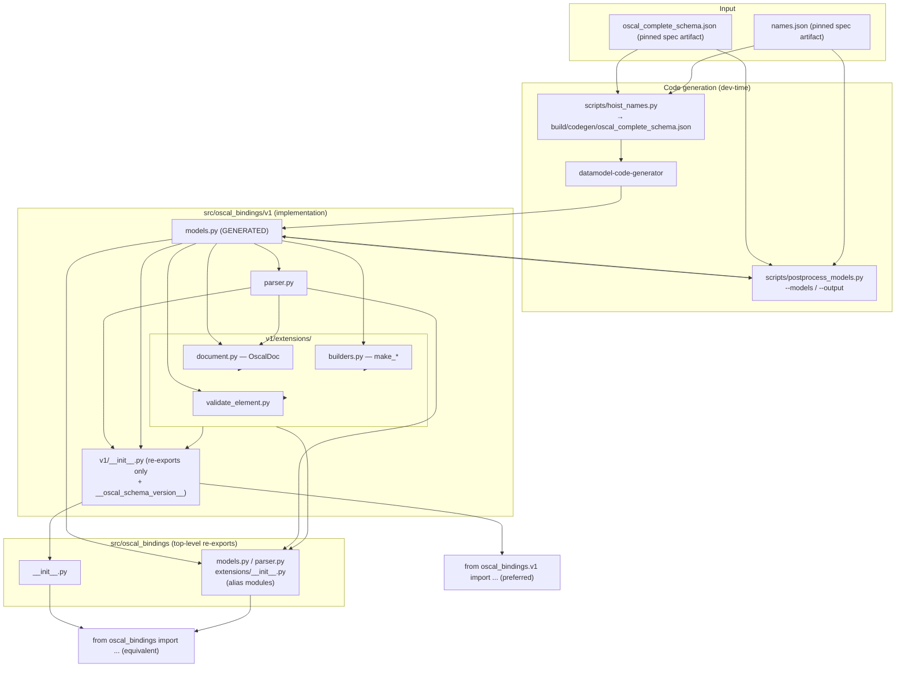

# Codebase Information

## Overview

`oscal-bindings` provides typed Python data bindings for [OSCAL](https://pages.nist.gov/OSCAL/) (Open Security Controls Assessment Language) release 1.2.3. The Pydantic v2 models are generated from the official NIST JSON Schema using `datamodel-code-generator`, with every type name taken from the naming manifest (`names.json`) of a pinned spec artifact of `cairn-proofs/oscal-bindings-specs`. A thin runtime layer adds parsing/serialization/validation utilities, and a hand-written `extensions` package layers uniform accessors, back-matter builders, and element-level validation on top of the generated models.

The implementation lives in a **major-version package**, `oscal_bindings.v1`. The top-level `oscal_bindings` re-exports it, so both `from oscal_bindings.v1 import ...` (preferred for new code) and the flat `from oscal_bindings import ...` resolve to the same objects.

- **Package name:** `oscal-bindings` (import as `oscal_bindings`, or `oscal_bindings.v1`)
- **Repository:** `cairn-proofs/oscal-bindings-python`. The `-python` suffix is for the repo only: sibling bindings in other languages live in `oscal-bindings-<lang>` repos, while each registry package uses that ecosystem's native name.
- **License:** Apache-2.0 (`LICENSE`); NIST attribution for the OSCAL JSON Schema, which the models are generated from, is in `NOTICE`.
- **Version:** 0.3.1
- **Language:** Python 3.11+ (test matrix: 3.11, 3.12, 3.13, 3.14)
- **Core runtime dependency:** Pydantic v2 (with `email` extra)
- **Build backend:** Hatchling
- **License / audience:** Developers building compliance tooling, GRC platforms, and security automation that consume/produce OSCAL documents.

## Supported Languages

| Language | Role | Analysis Coverage |
|----------|------|-------------------|
| Python | Entire library, tooling, tests | Full |
| JSON (schema) | Code-generation input, supplied by the pinned spec artifact (not in this repo) | Structural only — treated as input artifacts, not analyzed line-by-line |

No other programming languages are present. There are no compiled extensions, no C/Cython, and no frontend code.

## Technology Stack

| Concern | Tool |
|---------|------|
| Model validation (runtime) | Pydantic v2 |
| Code generation (dev only) | `datamodel-code-generator[http,black,isort]`, `jsonschema-rs` (manifest validation) |
| Build system / env management / test runner | Hatch (`hatchling` backend) |
| Lockfile generation | `hatch-pip-compile` (every Hatch env; hashed) |
| Resolver / installer | `uv`, behind `hatch-pip-compile` (no `uv.lock`) |
| Test framework | `pytest` (+ `hypothesis` for property tests) |
| Static typing | `mypy` |
| API docs | `pdoc` |
| Linting / formatting | `ruff` (configured in `pyproject.toml`) |
| Toolchain pinning | `mise.toml` + `mise.lock` (Python 3.14, uv, Hatch + hatch-pip-compile) |

## Directory Structure

```
oscal-bindings-python/
├── src/oscal_bindings/
│   ├── __init__.py              # Pure re-exports from .v1, defines nothing
│   ├── models.py                # Alias module → oscal_bindings.v1.models (NOT generated)
│   ├── parser.py                # Alias module → oscal_bindings.v1.parser
│   ├── extensions/
│   │   └── __init__.py          # Alias module → oscal_bindings.v1.extensions
│   └── v1/                      # THE implementation — OSCAL major version 1
│       ├── __init__.py          # Public API — re-exports ONLY, plus __oscal_schema_version__
│       ├── models.py            # GENERATED Pydantic v2 models (do not hand-edit)
│       ├── parser.py            # parse / serialize / validate + 8 typed parsers
│       └── extensions/          # Hand-written helpers on top of generated models
│           ├── __init__.py      # Re-exports extension symbols
│           ├── document.py      # OscalDoc facade (uniform accessors)
│           ├── builders.py      # make_hash / make_rlink / make_resource
│           └── validate_element.py  # Element-level schema validation
├── scripts/                     # Not a package; tests load scripts via tests/support/scripts.py
│   ├── spec_artifact.py         # Pin (version + sha256) of the spec artifact; shared by generate + tests
│   │                            # (the artifact supplies the OSCAL schema, names.json, and the corpus)
│   ├── pinned_archive.py        # Locked, sha256-checked fetch + safe extraction
│   ├── manifest.py              # Validates names.json of the pinned artifact
│   ├── hoist_names.py           # Writes build/codegen/oscal_complete_schema.json (manifest-named definitions)
│   └── postprocess_models.py    # Structure fixes, added manifest types, guards against the manifest
│                                # (takes --schema / --models / --output; --schema defaults to the
│                                # artifact schema, --output defaults to --models)
├── tests/                       # pytest suite (one file per source module)
│   └── support/                 # Importable test helpers (not collected)
│       ├── version_package.py   # Public-surface snapshot + schema $id helpers
│       ├── corpus.py            # Corpus helpers over the pinned spec artifact
│       ├── spec_artifact.py     # Reads the pin from scripts/spec_artifact.py
│       └── scripts.py           # load_script(): imports a module from scripts/
├── requirements.txt             # default-env lockfile (hatch-pip-compile output)
├── requirements/                # hatch-test (per Python) + hatch-build lockfiles
├── pyproject.toml               # Build config, deps, hatch envs/scripts
├── mise.toml / mise.lock        # Toolchain pins: Python 3.14, uv, Hatch (+ .mise/locks sidecar)
├── DEVELOPING.md                # Dev workflow + design-decision rationale
└── README.md                    # User-facing usage guide
```

## Codebase Structure Map



## Key Interfaces & Integration Points

- **Public API surface** — the entire public API is enumerated in `src/oscal_bindings/v1/__init__.py` `__all__`; the top-level `__init__.py` takes its `__all__` from that list rather than restating it, so the two cannot drift. Callers do `from oscal_bindings.v1 import <symbol>` (or the flat `from oscal_bindings import <symbol>`) without knowing the submodule.
- **Schema version introspection** — `__oscal_schema_version__` (`"1.2.3"`) on `oscal_bindings.v1`, re-exported at the top level. Tests check that it equals the release of the pin, and that the release of the pin matches the release element of the artifact schema `$id` (`.../ns/oscal/1.0/1.2.3/oscal-complete-schema.json`).
- **Parsing entry points** — `parse_oscal`, `parse_oscal_file`, and 8 typed parsers; all accept `str | bytes`.
- **Facade** — `OscalDoc` (uniform `metadata` / `uuid` / `oscal_version` / `body` / `assessment_period()` over all 8 document types).
- **Builders** — `make_hash`, `make_rlink`, `make_resource` for `back-matter` resource elements.
- **Element validation** — `validate_element`, `get_supported_element_types`.
- **Code-generation contract** — `oscal_complete_schema.json` + `names.json` of the pinned spec artifact → `src/oscal_bindings/v1/models.py` via `hatch run generate` (hoist + codegen + post-process). A cold cache needs network access, also in an sdist checkout. CI fails when the committed `models.py` differs from the generated one.

## Design Principles

- **Generated code stays pristine** — `v1/models.py` is a clean `datamodel-codegen` run plus a post-pass that adds manifest types and checks names. Convenience layers live in `v1/extensions/`, never injected into generated output.
- **No RootModel wrappers for scalars** — scalar fields are plain typed values with `Annotated` constraints, not wrapper objects (see `collapse_scalar_root_models`).
- **Names from the naming manifest** — every type name is a canonical name from `names.json` of the pinned spec artifact. The hoist makes each manifest site a named schema definition, and post-processor guards fail on any class name outside the manifest. The binding holds no naming rule for a manifest type.
- **Re-export-only packages** — neither `v1/__init__.py` nor the top-level `__init__.py` defines symbols; the full API is visible in one place.
- **Major-version namespace** — the binding namespace is scoped to the OSCAL *major* version (`v1`), because OSCAL is backward-compatible within a major version. A minor/patch refresh regenerates `v1` in place and never changes consumer import paths; OSCAL 2.0 would be the trigger for a second version package (see `DEVELOPING.md` Key Design Decisions).
- **Top-level re-exports** — the top-level import paths (`oscal_bindings`, `oscal_bindings.models`, `oscal_bindings.parser`, `oscal_bindings.extensions`) resolve to the *identical* objects as their `v1` counterparts, via explicit alias modules (not `sys.modules` tricks).

## Testing

- `pytest`, `testpaths = ["tests"]`, one test module per source module plus an import smoke test with top-level/v1 parity checks (`test_oscal_bindings.py`), manifest, hoist, and post-processor tests (`test_manifest.py`, `test_hoist_names.py`, `test_postprocess.py`, `test_prop_postprocess.py`), closed-enum tests (`test_closed_enums.py`), and shared helpers in `tests/support/` (`version_package.py`, `corpus.py`, `spec_artifact.py`, `scripts.py`).
- Matrix runs across Python 3.11, 3.12, 3.13, and 3.14 (`hatch test --all`), parallelized.
- Reports: terminal coverage plus `htmlcov/` (HTML, git-ignored), both from `hatch test --cover` via the overridden `cov-report` script.
