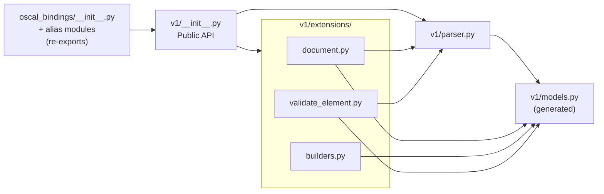

# Components

The library has six source components inside the version package `src/oscal_bindings/v1/` (plus the top-level re-export package, the code-generation scripts, and the test suite). Each maps to one file. All paths below are relative to `src/oscal_bindings/` unless noted.

## 1. `v1/models.py` — Generated models

**Responsibility:** Provide Pydantic v2 classes, enums, and type aliases for every OSCAL element across all 8 document types.

- **GENERATED — never hand-edit.** Regenerate with `hatch run generate`. (Not to be confused with the top-level `oscal_bindings/models.py`, which is a hand-written alias module.)
- Top of file carries the `datamodel-codegen` banner (filename only; `--disable-timestamp`).
- Contains 8 document wrappers (`CatalogDocument`, `ProfileDocument`, `ComponentDefinitionDocument`, `SystemSecurityPlanDocument`, `AssessmentPlanDocument`, `AssessmentResultsDocument`, `PlanOfActionAndMilestonesDocument`, `MappingCollectionDocument`) plus the union root `OscalDocument`.
- Body models: `Catalog`, `Profile`, `SystemSecurityPlan`, `AssessmentPlan`, `AssessmentResults`, `PlanOfActionAndMilestones`, `ComponentDefinition`, `MappingCollection`, and hundreds of nested element models.
- Every type name is a canonical name from the naming manifest (`names.json` of the pinned spec artifact).
- Shared elements: `Metadata`, `BackMatter`, `BackMatterResource`, `BackMatterResourceRlink`, `Hash`, `DocumentId`, `Link`, `Property`, `MetadataRole`, `MetadataParty` (union alias), `Parameter` (union alias), `Part`, etc.
- 44 enums: `HashAlgorithm` (SHA-224 … SHA3-512), `LinkRel`, `ImplementationStatusState`, `ParameterSelectionHowMany`, and others. Closed enums are the field type; open enums are a union with the base datatype.
- 13 union `TypeAlias`es (`CatalogGroup`, `Merge`, `ProfileGroup`, `TaskTiming`, …), plus scalar `Annotated` aliases named from schema definition keys (`LocationUuid`).
- Models use `ConfigDict(extra='forbid')` and camelCase JSON aliases (e.g. `media-type`, `oscal-version`, `document-ids`).
- Every object model subclasses `OscalBaseModel` (`--base-class`); `OscalDocument` and `MappingCollectionMappings` stay `RootModel[...]`.

### 1a. `v1/_base.py` — `OscalBaseModel` (hand-written)

**Responsibility:** Default behavior inherited by all 185 generated object models. Imports only `pydantic` and stdlib.

| Symbol | Purpose |
|--------|---------|
| `OscalBaseModel.model_config` | `serialize_by_alias=True`; deliberately no `validate_by_name` / `populate_by_name` |
| `OscalBaseModel._omit_none` | Wrap `model_serializer` that drops None values, so no path emits `null`; no return annotation (it would blank the serialization JSON schema) |
| `OscalBaseModel.__init__` | Maps field-name kwargs to aliases; leaves the name if the alias is also passed so `extra='forbid'` rejects it. Marked `__pydantic_base_init__ = True` so `model_validate*` doesn't route through it |
| `_kwarg_aliases(cls)` | `functools.cache`'d `{name: alias}` for alias-differing fields, excluding names that are also some field's alias |

## 2. `v1/parser.py` — Runtime parse/serialize/validate

**Responsibility:** Convert JSON ⇄ models and validate.

| Symbol | Kind | Purpose |
|--------|------|---------|
| `parse_oscal(data)` | function | `str \| bytes` → `OscalDocument` via `model_validate_json` |
| `parse_oscal_file(path)` | function | Reads file as **bytes**, delegates to `parse_oscal` |
| `serialize_oscal(model, *, indent=2)` | function | `model_dump_json(by_alias=True, exclude_none=True)` |
| `validate_oscal(data)` | function | Returns `bool`, swallows errors |
| `parse_catalog`, `parse_profile`, `parse_component_definition`, `parse_system_security_plan`, `parse_assessment_plan`, `parse_assessment_results`, `parse_plan_of_action_and_milestones`, `parse_mapping_collection` | functions | Typed parsers; each `hasattr`-checks `doc.root` for the expected body attr, else raises `OscalParseError` |
| `OscalParseError` | class | Raised on parse/validation failure; carries `.errors` (list of Pydantic error dicts) |

## 3. `v1/extensions/document.py` — `OscalDoc` facade

**Responsibility:** Uniform, type-agnostic access to any parsed OSCAL document.

- `OscalDoc` uses `__slots__ = ("_wrapper",)`; constructor accepts an `OscalWrapper` or an `OscalDocument` (unwraps `.root`), else raises `TypeError`.
- Classmethods `from_json(str|bytes)` and `from_file(path)`.
- Properties: `wrapper`, `body`, `metadata`, `oscal_version`, `uuid`.
- `assessment_period() -> (date|None, date|None)` — defined only for Assessment Plan (walks `tasks[].timing`, including nested subtasks: `on-date`, `within-date-range`; `at-frequency` contributes nothing) and Assessment Results (aggregates `results[].start`/`.end`). Earliest start / latest end win. Raises `OscalAccessError` on other types.
- Type unions `OscalBody` and `OscalWrapper` (each an 8-way union), and the module-private `_WRAPPER_TO_BODY_ATTR` dispatch map.
- `OscalAccessError` — raised when a typed accessor is used on the wrong document type.

## 4. `v1/extensions/builders.py` — back-matter builders

**Responsibility:** Ergonomic constructors for `back-matter` resource elements.

| Function | Notes |
|----------|-------|
| `make_hash(value, algorithm=HashAlgorithm.SHA_256)` | Accepts enum or string (`"SHA-256"`); coerces string via `HashAlgorithm(...)` |
| `make_rlink(href, *, media_type=None, hashes=None)` | `BackMatterResourceRlink(href=..., media_type=..., hashes=...)` — by-name kwargs via `OscalBaseModel` |
| `make_resource(*, title, description, rlinks, uuid, document_ids)` | Generates a UUID4 when `uuid` omitted; one `BackMatterResource(...)` call, so `document_ids` is validated at construction (`[]` or non-`DocumentId` items raise `ValidationError`) |

## 5. `v1/extensions/validate_element.py` — element-level validation

**Responsibility:** Validate an arbitrary OSCAL element fragment (a dict) against its model.

- `_pascal_to_kebab(name)` — converts model class names to kebab element types.
- `_build_element_map()` — introspects `oscal_bindings.v1.models` for all `BaseModel` subclasses except `BaseModel` and `OscalBaseModel` themselves, building `{kebab-name: model class}`; result cached in module-level `_ELEMENT_MAP`. The pre-existing `root-model` entry (from the `RootModel` import) is kept; the set is pinned by `tests/support/element_types_snapshot.txt`.
- `validate_element` calls `model_validate(element)` with no extra kwargs; dict input stays alias-only from the models' defaults.
- `get_supported_element_types() -> list[str]` — sorted kebab names.
- `validate_element(element: dict|None, element_type: str) -> ElementValidationResult` — raises `OscalParseError` for unknown types; otherwise returns a result with `valid` and a list of `ValidationError(path, message)`.
- Dataclasses `ElementValidationResult` and `ValidationError` (re-exported as `ElementValidationError`).

## 6. `v1/__init__.py` — version package surface

**Responsibility:** Enumerate the public API for OSCAL major version 1, and record the exact schema release.

- Re-exports only; defines no symbols of its own beyond `__oscal_schema_version__`.
- `from .models import *`, then explicit named imports from `.parser` and `.extensions`.
- `__oscal_schema_version__ = "1.2.3"` — the full OSCAL release the vendored bundle (and therefore the models) came from. A literal by design; a test asserts it against the release element of the bundle's schema `$id`.
- `__all__` is the curated ~35-name surface (wrappers, parsers, facade, builders, validation, exceptions); the generated model names arrive via the star-import and are intentionally *not* in `__all__`.

## 7. Top-level re-exports — `oscal_bindings/`

**Responsibility:** Expose the `v1` surface at the top level (`oscal_bindings`, `.models`, `.parser`, `.extensions`), resolving to the identical objects. Four hand-written files, none of them generated:

| File | Behavior |
|------|----------|
| `__init__.py` | `from oscal_bindings.v1.models import *` (carries the generated names — bounded by `v1.__all__` if routed through `v1`, hence the direct import), `from oscal_bindings.v1 import *`, explicit re-export of `__oscal_schema_version__`, and `__all__ = list(v1.__all__)` so the surfaces cannot drift |
| `models.py` | `from oscal_bindings.v1.models import *` |
| `parser.py` | Re-exports `oscal_bindings.v1.parser` |
| `extensions/__init__.py` | Re-exports `oscal_bindings.v1.extensions`, with `__all__ = list(v1.extensions.__all__)` |

Explicit alias modules, not `sys.modules` aliasing — greppable, and `mypy`/`pdoc` handle them without special cases.

## 8. `scripts/` — code generation and release tooling

Not part of the installed package. `scripts/` is not a package: a script imports its siblings by plain name, and tests load scripts through `tests/support/scripts.py` (`load_script`). See `workflows.md` for the step sequence and `architecture.md` for the guards.

| File | Responsibility | Notable symbols |
|------|----------------|-----------------|
| `spec_artifact.py` | The one pin of the spec artifact (`0.2.0+oscal.1.2.3` + sha256), shared by `generate` and the tests; cache `tests/.corpus_cache/` | `SPEC_ARTIFACT_VERSION`, `SPEC_ARTIFACT`, `OSCAL_RELEASE`, `ensure_spec_artifact`, `artifact_paths` |
| `pinned_archive.py` | Stdlib-only, cross-process-locked download, sha256 check before extraction, tar-slip-safe extraction, atomic publish | `PinnedArchive`, `ensure_pinned_archive`, `CorpusError`, `FileLock` |
| `manifest.py` | Validates `names.json`: JSON Schema (`jsonschema-rs`), format/release, vendored-schema sha256, unique names, resolvable pointers, type references | `validate_manifest`, `load_validated_manifest`, `ManifestError`, `VENDORED_SCHEMA` |
| `hoist_names.py` | Writes `build/codegen/oscal_complete_schema.json`, in which each manifest site is `definitions/<Name>` with a `$ref` at the site | `hoist`, `HoistError`, `OUTPUT` |
| `postprocess_models.py` | Phase 1 structure fixes, adds union aliases / `MappingCollectionMappings` / `OscalDocument`, names scalar aliases, applies three guards against the manifest | `postprocess`, `guard_failures`, `PostprocessError`, `add_union_aliases`, `add_single_or_many`, `rename_document_union`, `scalar_renames`, `collapse_scalar_root_models`, `fix_non_string_patterns`, `ACTIVE_SCHEMA_RELEASE`, `parse_args`/`main` (`--models`/`--schema`, each with its own default) |
| `name_changes.py` | Writes `build/name-changes.md`, the release-notes list of renamed, reused, removed, and added names and changed element types, against the merge base with `main` | `compare`, `render`, `build_document`, `NameChangesError` |
| `bench_serialization.py` | Serialization benchmark (see `DEVELOPING.md`) | — |

## 9. `tests/` — test suite

| Module | Covers |
|--------|--------|
| `test_parser.py`, `test_document.py`, `test_builders.py`, `test_validate_element.py` | One per source component; test classes group scenarios (`TestAssessmentPeriod`, `TestMakeResource`, `TestTypedParsers`) |
| `test_oscal_bindings.py` | Import smoke test **and** top-level parity: every name in the public-surface snapshot imports from `oscal_bindings`, all three top-level module paths resolve, type identity holds across paths, and `__oscal_schema_version__` is semver-shaped and matches the bundle `$id` |
| `test_manifest.py` | Manifest validation: the released manifest passes; changed copies fail each check |
| `test_hoist_names.py` | Hoist: every site becomes a `$ref`, no old site keys remain, deterministic output, merge and closed-enum guards, and corpus-level equivalence of the hoisted and vendored schemas |
| `test_postprocess.py` | Post-processor units: phase 1, the added manifest types, the three guards (each lists every offender), and CLI argument combinations |
| `test_prop_postprocess.py` | Hypothesis property tests for the post-processor |
| `test_closed_enums.py` | Closed enums accept their values, reject others with `OscalParseError`, and serialize back to strings |
| `test_name_changes.py` | The release-notes name-change list |
| `test_prop_version_package.py` | Properties 3–6: published-surface round trip, type identity across the top-level and `v1` paths, version-constant consistency, namespace stability |
| `support/version_package.py` | Public-surface `__all__` snapshot and schema `$id` helpers shared by the import-path tests |
| `support/corpus.py` | Shared fixtures/corpus helpers; imports `PinnedArchive` from `scripts/pinned_archive.py` |
| `support/spec_artifact.py` | Reads the pin from `scripts/spec_artifact.py` |
| `support/scripts.py` | `load_script(name)`: loads `scripts/<name>.py` in the test process |
