# Data Models

All data models live in the generated `src/oscal_bindings/v1/models.py` (Pydantic v2), generated from OSCAL release 1.2.3. This document describes their structure and the conventions that apply across them. **Do not hand-edit `v1/models.py`** — change the hoist, the post-processor, or the store manifest and regenerate. The top-level `oscal_bindings/models.py` is a hand-written alias module that re-exports the same class objects, so `oscal_bindings.Catalog is oscal_bindings.v1.models.Catalog`.

## Document Type Hierarchy

Every OSCAL JSON document has a single top-level key naming its type. That maps to a **wrapper** class holding one **body** field (plus the `$schema` directive field). Each wrapper is a `document` entry of the naming manifest.

```mermaid
classDiagram
    class OscalDocument {
        <<union root>>
        +root: one of the 8 wrappers
    }
    class CatalogDocument {
        +catalog: Catalog
    }
    class ProfileDocument {
        +profile: Profile
    }
    class SystemSecurityPlanDocument {
        +system_security_plan: SystemSecurityPlan
    }
    class AssessmentPlanDocument {
        +assessment_plan: AssessmentPlan
    }
    class AssessmentResultsDocument {
        +assessment_results: AssessmentResults
    }
    class PlanOfActionAndMilestonesDocument {
        +plan_of_action_and_milestones: PlanOfActionAndMilestones
    }
    class ComponentDefinitionDocument {
        +component_definition: ComponentDefinition
    }
    class MappingCollectionDocument {
        +mapping_collection: MappingCollection
    }
    OscalDocument --> CatalogDocument
    OscalDocument --> ProfileDocument
    OscalDocument --> SystemSecurityPlanDocument
    OscalDocument --> AssessmentPlanDocument
    OscalDocument --> AssessmentResultsDocument
    OscalDocument --> PlanOfActionAndMilestonesDocument
    OscalDocument --> ComponentDefinitionDocument
    OscalDocument --> MappingCollectionDocument
```

`OscalDocument` is a Pydantic `RootModel` (the manifest's `document-union` entry, added by the post-processor); its `.root` holds whichever wrapper matched. Typed parsers and `OscalDoc` hide the `.root` access.

## Wrapper → Body Mapping

`OscalDoc._WRAPPER_TO_BODY_ATTR` encodes the body field name for each wrapper:

| Wrapper | Body attribute | Body type |
|---------|----------------|-----------|
| `CatalogDocument` | `catalog` | `Catalog` |
| `ProfileDocument` | `profile` | `Profile` |
| `SystemSecurityPlanDocument` | `system_security_plan` | `SystemSecurityPlan` |
| `AssessmentPlanDocument` | `assessment_plan` | `AssessmentPlan` |
| `AssessmentResultsDocument` | `assessment_results` | `AssessmentResults` |
| `PlanOfActionAndMilestonesDocument` | `plan_of_action_and_milestones` | `PlanOfActionAndMilestones` |
| `ComponentDefinitionDocument` | `component_definition` | `ComponentDefinition` |
| `MappingCollectionDocument` | `mapping_collection` | `MappingCollection` |

Every body type carries a top-level `uuid` and a `metadata` block, which is what `OscalDoc.uuid` / `.metadata` / `.oscal_version` rely on.

## Shared Elements

These recur across document types:

- **`Metadata`** — title, version, `oscal-version`, roles, parties, responsible parties, revisions, links, props.
- **`BackMatter`** → **`BackMatterResource`** → **`BackMatterResourceRlink`**, **`Hash`**, **`DocumentId`**, **`BackMatterResourceCitation`**, **`BackMatterResourceBase64`** — the back-matter resource tree targeted by the builder helpers.
- **`Property`**, **`Link`**, **`Part`**, **`Parameter`** (union alias of `ParameterWithSelect | ParameterWithValues`) — annotation/structuring primitives.
- **`MetadataRole`**, **`MetadataParty`** (union alias), **`MetadataLocation`**, **`ResponsibleParty`**, **`ResponsibleRole`** — actors.
- **`Address`**, **`TelephoneNumber`**, **`MetadataRevision`** — sub-elements.

## Model Conventions

| Convention | Detail |
|------------|--------|
| Base class | Every object model subclasses `OscalBaseModel` (`v1/_base.py`, via `--base-class`); `OscalDocument` and `MappingCollectionMappings` stay `RootModel` |
| Config | `ConfigDict(extra='forbid')` — unknown JSON keys are rejected; merged with the base's `serialize_by_alias=True` |
| Field aliases | JSON uses kebab/camelCase (`media-type`, `oscal-version`, `document-ids`); Python attrs use snake_case; aliases bridge them |
| Serialization | Alias keys and no `null` on every path by default (wrap `model_serializer` drops None); `by_alias=False` emits names; `exclude_none=False` is a no-op |
| By-name input | Constructor kwargs accept names or aliases (`BackMatterResourceRlink(media_type=...)`). `model_validate({...})` stays alias-only (`extra_forbidden` at any depth); JSON never populates from a name key (dropped on pydantic 2.13.x, rejected on 2.11.0; [#6](https://github.com/cairn-proofs/oscal-bindings-python/issues/6)). No `validate_by_name` in config |
| Constraints | `Annotated[T, Field(...)]` with `pattern`, `min_length`, etc. (produced by `--field-constraints`) |
| Scalars | Collapsed to `TypeAlias` (not `RootModel`) — e.g. a `uuid` field is a constrained `str`, accessed directly |
| Datetimes | `AwareDatetime`; `pattern=` constraints stripped by the post-processor since they're invalid on non-str types |
| Emails | `EmailStr`; redundant `pattern=` stripped |

## Naming

Every type name comes from the naming manifest (`names.json`) of the pinned spec artifact (`scripts/spec_artifact.py`). The binding holds no naming rule for a manifest type. Manifest kinds map to Python forms:

| Manifest kind | Python form | Example |
|---------------|-------------|---------|
| `object` | `OscalBaseModel` subclass | `BackMatterResourceRlink` |
| `document` | `OscalBaseModel` subclass (wrapper) | `CatalogDocument` |
| `enum` | `Enum` class | `HashAlgorithm`, `ParameterSelectionHowMany` |
| `union` | `TypeAlias` of the variants, in manifest order | `CatalogGroup = CatalogGroupWithControls \| CatalogGroupWithGroups` |
| `single-or-many` | `RootModel[T \| list[T]]` | `MappingCollectionMappings` |
| `document-union` | `RootModel` of the 8 wrappers | `OscalDocument` |

Scalar definitions have no manifest entry. Their `Annotated` aliases take the definition key without the `oscal-complete-oscal-<module>:` prefix (`LocationUuid`). The post-processor guards fail the build on a missing manifest name, a name outside the manifest that is not a scalar alias, or a name defined twice. To change a name, change the manifest in the store.

When an object matches more than one union variant, pydantic selects the first variant in manifest order. For example, a `Parameter` with neither `select` nor `values` parses as `ParameterWithSelect`. The serialized output is the same.

Some short names occur in more than one document namespace. The manifest gives each a distinct name, for example:

| Schema key (namespace : short-name) | Python class |
|-------------------------------------|--------------|
| `...component-definition:control-implementation` | `ComponentDefinitionControlImplementation` |
| `...ssp:control-implementation` | `SspControlImplementation` |
| `...catalog:group` | `CatalogGroup` (union alias) |
| `...profile:group` | `ProfileGroup` (union alias) |
| `...component-definition:implemented-requirement` | `ComponentDefinitionImplementedRequirement` |
| `...ssp:implemented-requirement` | `SspImplementedRequirement` |
| `...control-common:select-control-by-id` | `ControlCommonSelectControlById` |
| `...assessment-common:select-control-by-id` | `AssessmentCommonSelectControlById` |
| `...component-definition:statement` | `ComponentDefinitionStatement` |
| `...ssp:statement` | `SspStatement` |

Union variants have descriptive manifest names: `Merge` = `MergeWithAsIs | MergeWithCustom | MergeWithFlat`, `CatalogGroup` = `CatalogGroupWithControls | CatalogGroupWithGroups`. `MergeFlat` and `MergeCustom` are the `flat` and `custom` directive objects inside those variants.

## Enums

44 enum classes, each with its manifest name. Notable enum: **`HashAlgorithm`** (`SHA-224`, `SHA-256`, `SHA-384`, `SHA-512`, `SHA3-224`, `SHA3-256`, `SHA3-384`, `SHA3-512`) — used by `make_hash`.

1. **Closed enum** (`allOf` of a base datatype and an `enum`): the field type is the enum class, for example `how_many: ParameterSelectionHowMany | None`. A value outside the enum fails validation.
2. **Open enum** (`anyOf` of a base datatype and an `enum`): the field type is the union of the base datatype alias and the enum class, so other values are accepted.

Both serialize to the value string.

## Element Validation Model

`v1/extensions/validate_element.py` builds `_ELEMENT_MAP` by introspecting every `BaseModel` subclass in `v1/models.py` (excluding `BaseModel` and `OscalBaseModel` themselves) and converting its class name to kebab-case. So the set of validatable element types is derived directly from the generated model classes — see `get_supported_element_types()` for the live list (includes `catalog`, `metadata`, `observation`, `back-matter`, `back-matter-resource-rlink`, etc.).
