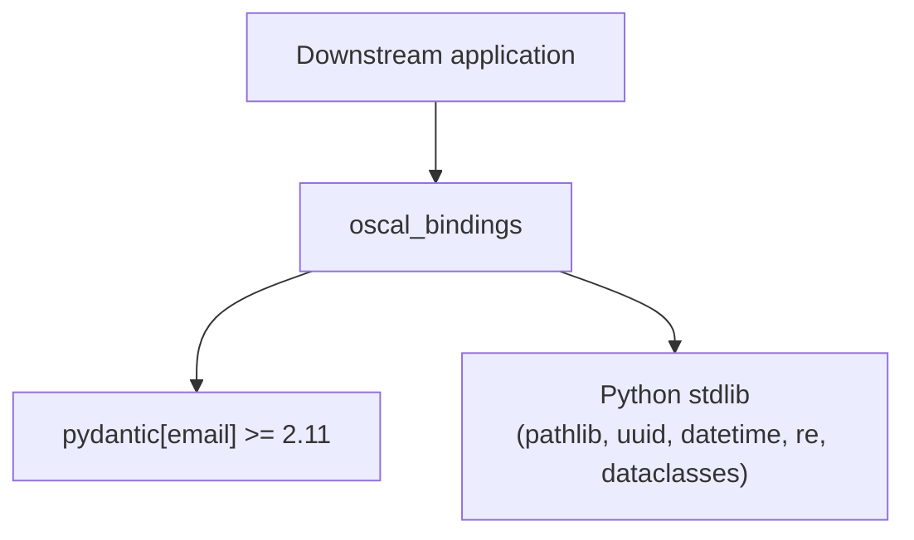

# Dependencies

## Runtime Dependencies

Declared in `pyproject.toml` `[project.dependencies]`.

| Dependency | Constraint | Why it's needed |
|------------|-----------|-----------------|
| `pydantic[email]` | `>=2.11` | The generated models are Pydantic v2 models (via `OscalBaseModel`). The `email` extra provides `EmailStr` validation used by contact fields. The 2.11 floor is for `ConfigDict(serialize_by_alias=True)` in `v1/_base.py`; the runtime also uses v2-only APIs (`model_validate_json`, `model_dump_json`, `RootModel`, `model_serializer`). The full serialization/parser/preservation suites pass on 2.11.0. |

That is the **only** runtime dependency. The library is otherwise pure standard library (`pathlib`, `uuid`, `datetime`, `re`, `dataclasses`, `enum`, `typing`).

## Optional / Codegen Dependency

Declared under `[project.optional-dependencies]` as the `codegen` extra:

| Dependency | Purpose |
|------------|---------|
| `datamodel-code-generator[http]` | Generates `src/oscal_bindings/v1/models.py` from the OSCAL JSON Schema. Dev/build-time only — **not** required to *use* the library, only to *regenerate* it. The `http` extra lets the generator resolve remote `$ref`s if needed. |

## Development Toolchain

Managed through Hatch environments (`[tool.hatch.envs.default.dependencies]`) rather than as project deps:

| Tool | Role |
|------|------|
| `pytest` | Test runner (`testpaths = ["tests"]`; coverage run under `hatch test --cover`) |
| `hypothesis` | Property-based tests (`tests/test_prop_*.py`); supplied via `extra-dependencies` on `[tool.hatch.envs.hatch-test]`, not a project dep |
| `jsonschema-rs` | `==0.58.6` in the default env, where `hatch run generate` validates `names.json` against its JSON Schema (`scripts/manifest.py`). Also in `hatch-test` `extra-dependencies`, at the same version through the `default` constraint: validates serialized output against the OSCAL schema of the pinned spec artifact (`tests/test_schema_validation.py`) and the hoisted schema against the corpus (`tests/test_hoist_names.py`). Compiled, so it stays fast under coverage, and its regex engine supports the `\p{L}`/`\p{N}` classes in OSCAL patterns |
| `mypy` | Static type checking (`hatch run typing`, over `src/oscal_bindings` including `v1`) |
| `datamodel-code-generator[http,black,isort]` | `==0.83.0` in the default env for `hatch run generate` |
| `pdoc` | API documentation (`hatch run docs` → `build/api-docs`) |
| `ruff` | Linting and formatting; configured in `pyproject.toml` (`[tool.ruff]`, line length 88, `py311` target, first-party `oscal_bindings`) and pinned (`ruff==0.16.8`) in the default env; `hatch run lint` is the single entry point |

## Build / Environment Tooling

| Tool | Role |
|------|------|
| Hatch (`hatchling` backend) | Build backend + environment/script management. Wheel packages `src/oscal_bindings`; build output goes to `./build`. |
| `hatch-pip-compile` (`==1.11.8`) | Env type for `default`, `hatch-test`, `hatch-build`, `security`; writes hashed lockfiles `requirements.txt` and `requirements/requirements-hatch-{test.py3.11,test.py3.12,test.py3.13,test.py3.14,build}.txt` plus `requirements/requirements-security.txt`. `hatch-test` is constrained by `default`. |
| `uv` | Resolver and installer behind `hatch-pip-compile`. No `uv.lock`: the pip-compile lockfiles are the single lock system. `[tool.uv.workspace]` is still declared. |
| `mise` | Sole installer of the toolchain, locally and in CI (`jdx/mise-action`): Python 3.14, uv, and Hatch 1.18.1 with `hatch-pip-compile` injected, locked with hashes in `mise.lock` + `.mise/locks/`. |

## Python Version Support

- **Requires** Python `>=3.11` (`requires-python`).
- **Tested** on 3.11, 3.12, 3.13, and 3.14 (`[[tool.hatch.envs.hatch-test.matrix]]`, parallel).
- Codegen targets 3.11 syntax (`--target-python-version 3.11`), so generated models use `X | Y` unions and `list[...]` builtins.
- mypy checks against 3.11 (`[tool.mypy] python_version`) and ruff targets `py311`, matching the floor rather than the toolchain.
- `mise.toml` and the `default` and `security` hatch envs use 3.14; `hatch-build` follows the mise interpreter.

## Schema Input (not a package dependency)

This repo holds no copy of the OSCAL JSON Schema. The store vendors the NIST schema, and the pinned spec artifact supplies it (see below). The complete schema of the artifact, `oscal_complete_schema.json`, is the single source of codegen. The hoist, the manifest check, the post-processor, and the tests read it through `artifact_paths(ensure_spec_artifact()).schema`, at call time. The schema is not installed with the package, and the sdist does not ship it. That is why `__oscal_schema_version__` is a literal on `oscal_bindings.v1`, not parsed from the schema at import time.

The pin is the only selector of the schema and its release. Codegen reads the hoisted copy `build/codegen/oscal_complete_schema.json`, a git-ignored build file.

## Spec Artifact (not a package dependency)

`scripts/spec_artifact.py` pins the spec artifact of [cairn-proofs/oscal-bindings-specs](https://github.com/cairn-proofs/oscal-bindings-specs) (`0.3.0+oscal.1.2.3`) by sha256. It holds the complete OSCAL JSON Schema, the naming manifest (`names.json` and its JSON Schema), and the conformance corpus. `hatch run generate` and `hatch test` share the pin and the cache `tests/.corpus_cache/`, so a cold cache needs network access once. An sdist checkout needs network access too, to run `generate`.

## Dependency Risk Notes

- **Single tight runtime coupling to Pydantic v2.** A Pydantic 3.x major release could require regeneration and code changes in `v1/_base.py`, `v1/parser.py`, and `v1/extensions/`. This is the main upgrade-watch item. `OscalBaseModel` also relies on the undocumented `__pydantic_base_init__` marker (tripwire tests guard it), and name-keyed JSON handling varies by minor version: 2.11.0 rejects with `extra_forbidden`, 2.13.x silently drops ([#6](https://github.com/cairn-proofs/oscal-bindings-python/issues/6)).
- **Codegen reproducibility** depends on the pinned `datamodel-code-generator` version *and* its transitive formatters (black, isort), all captured in the `requirements.txt` lockfile. Regenerating under the lock reproduces `v1/models.py` byte-for-byte. Class names do not depend on generator heuristics: each class takes its name from a hoisted definition key, and the post-processor guards fail the build if any class name differs from the manifest.
- **`extra='forbid'` ties coverage to the release of the pin.** A document using a field added after that release is rejected rather than ignored, so "supports OSCAL 1.x" means "supports 1.2.3 and earlier". `__oscal_schema_version__` is the introspection mechanism; a lenient mode is deferred, not rejected (see `DEVELOPING.md` Key Design Decisions).
- **No transitive runtime deps beyond Pydantic and its own deps**, keeping the install surface small for downstream compliance tooling.
