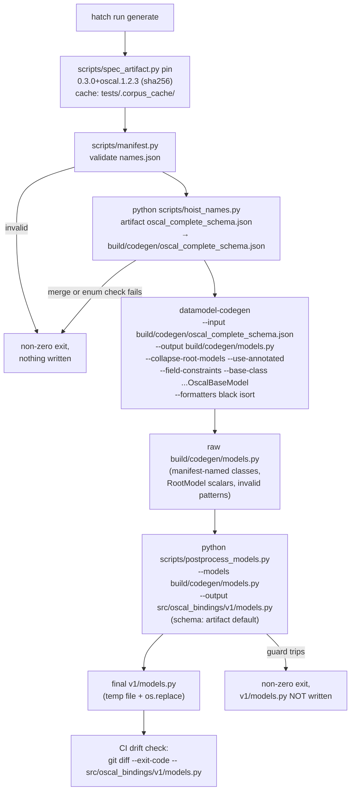
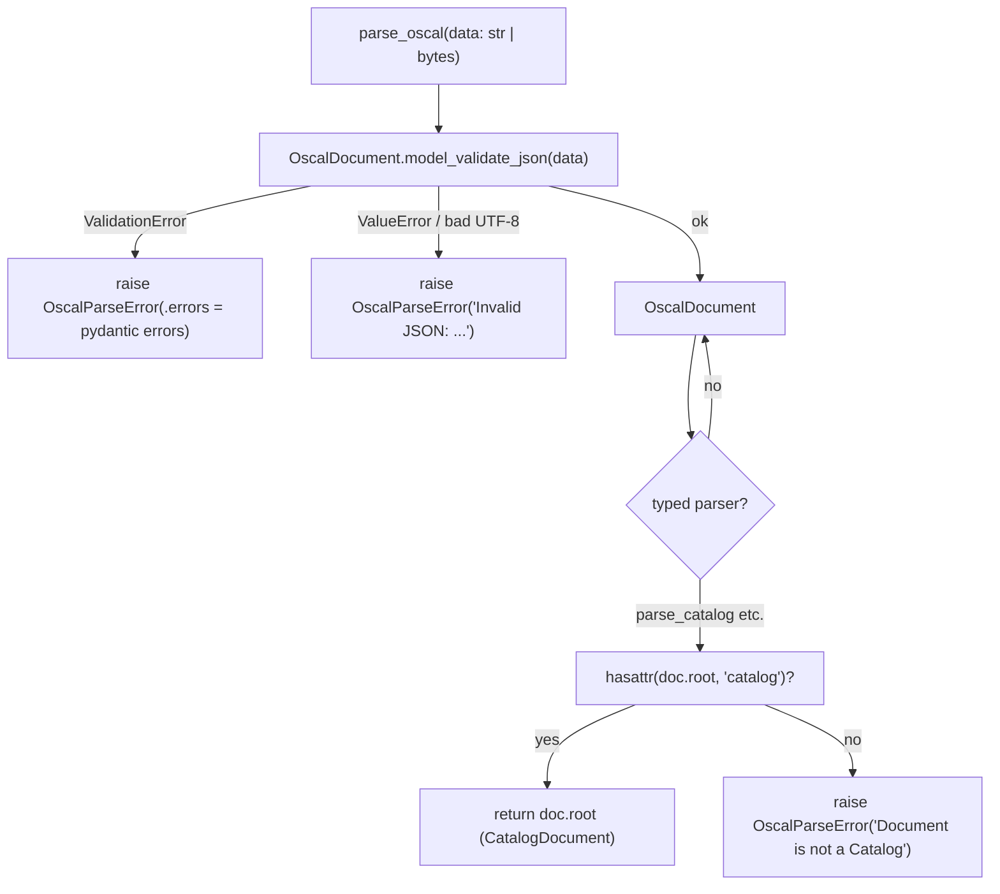
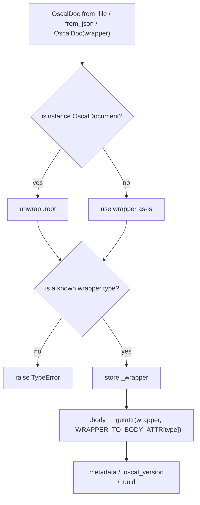
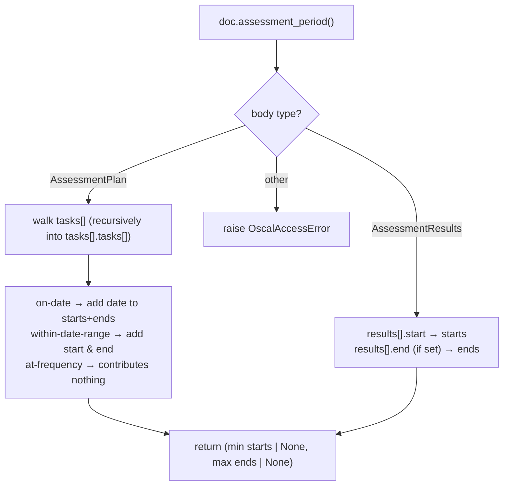
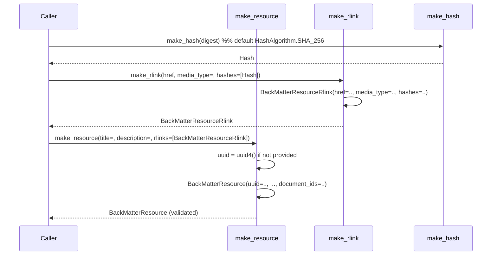
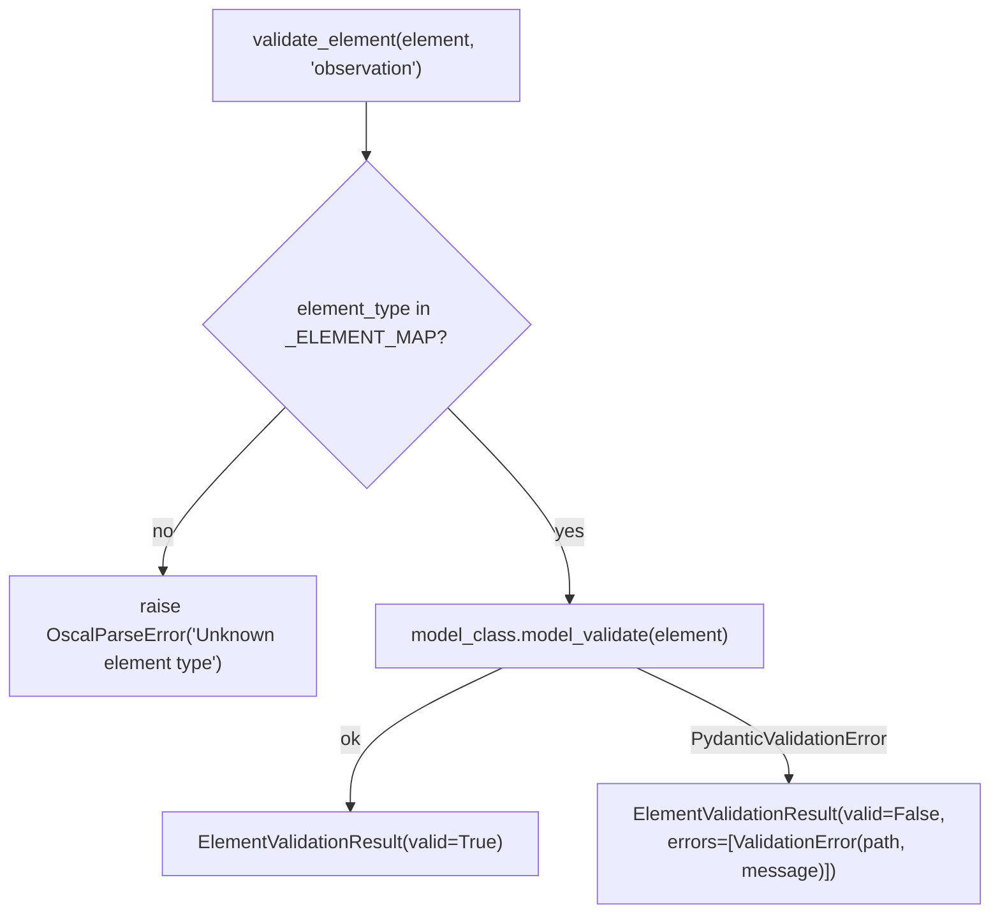
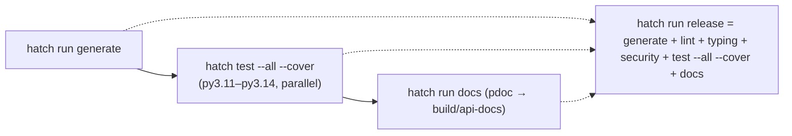

# Workflows

## 1. Code Generation (build-time)

Triggered by `hatch run generate`. This is the only supported way to change `v1/models.py`. Every type name comes from
the naming manifest (`names.json`) of the pinned spec artifact. The binding holds no naming rule for a manifest type.

### 1a. Hoist (`scripts/hoist_names.py`)

1. `load_validated_manifest` (`scripts/manifest.py`) checks `names.json` in order: the manifest JSON Schema of the same
   artifact (`jsonschema-rs`), the format version and OSCAL release, `schema.sha256` against the artifact schema bytes,
   then unique names, pointers that occur once and resolve, and type references that name an entry. It raises
   `ManifestError` with every failure. The hoist reads the schema bytes from `paths.schema` one time and parses the
   same bytes that the check hashed.
2. `hoist` copies the subschema at the first site of each entry to `definitions/<Name>` and replaces each site with a
   `$ref`, deepest sites first.
3. For an entry with more than one site, the bodies must be equal (annotations ignored). A mismatch raises `HoistError`
   and names both sites.
4. Each `$ref` to an old definition key that was a site is rewritten, and the old key is removed. Scalar definitions
   keep their keys.
5. A closed-enum site (`enum` branch of an `allOf` with a base datatype) replaces the whole `allOf`. Each enum value
   must be valid for the base datatype. An open-enum site replaces only the `enum` branch of its `anyOf`.
6. Property `title`/`description` stay beside the `$ref`, and a union branch without a `description` takes that of its
   union, so fields and variant classes keep their docs.

The output is deterministic: two runs give byte-identical copies.

### 1b. Post-process (`scripts/postprocess_models.py`)

`postprocess()` runs these steps in order:

1. **`add_single_or_many`** — `MappingCollectionMappings` as `RootModel[Mapping | list[Mapping]]`, replacing the inline
   union of the field.
2. **Phase 1** — `collapse_scalar_root_models` (scalar `RootModel[...]` → `Annotated` alias, manifest root models
   kept), `ensure_annotated_import`, `fix_email_str_patterns` / `fix_non_string_patterns` (strip `pattern=` from
   `EmailStr`, `AwareDatetime`, `AnyUrl`, and numeric fields).
3. **`scalar_renames`** — each scalar alias is named from its definition key without the `oscal-complete-oscal-<module>:`
   prefix (`LocationUuid`). A target name that is not PascalCase (`[A-Z][A-Za-z0-9]*`), or that a module-level import
   binds, is a failure.
4. **`rename_document_union`** — the root `RootModel` gets its manifest name, `OscalDocument`.
5. **`add_union_aliases`** — one `TypeAlias` per `union` entry, in manifest order, after the last variant class
   (`CatalogGroup: TypeAlias = CatalogGroupWithControls | CatalogGroupWithGroups`). `replace_inline_unions` replaces
   each inline union of exactly the variant set with the alias.
6. **Cleanup** — drop an unused `RootModel` import, collapse 4+ blank lines.
7. **`guard_failures`** — three guards, each reporting every offender: each manifest name is defined once at module
   level in the form of its kind; each other module-level name is a scalar alias named for a scalar definition of the
   artifact schema (`scalar_names`); no name is defined twice, no scalar alias has a manifest name, and no manifest
   name or scalar alias is bound by a module-level import (`import_bindings`). Any failure raises `PostprocessError`.

`main` reads the codegen output at `--models` (`build/codegen/models.py` in `generate`) and writes the completed module
to `--output` (`src/oscal_bindings/v1/models.py`) through a temp file in the same directory and `os.replace`. On any
failure nothing is written to `--output`, so the committed module stays as it was. `--schema` and `--models` each carry
their own default (`DEFAULT_MODELS_PATH` for `--models`). `generate` passes no `--schema`, and `main` resolves an
omitted `--schema` to `artifact_schema_path()`, the schema of the pinned spec artifact. `--output` defaults to
`--models`. `main` reads the schema bytes one time, and `load_manifest(schema_bytes)` requires the manifest to record
their sha256. A missing path exits non-zero naming it. Re-running `hatch run generate` gives the same output for the
same schema and manifest. After `hatch run release`, CI runs `git diff --exit-code -- src/oscal_bindings/v1/models.py`
and fails the `build` job on a difference.

## 1c. Moving the pin to a new spec artifact

The repo holds no copy of the OSCAL schema. The pin in `scripts/spec_artifact.py` is the only selector of the schema
and its release (`OSCAL_RELEASE`, from the `+oscal.<release>` build metadata). See `DEVELOPING.md` "Moving the pin to a
new spec artifact" for the full procedure and the reviewer checks.

1. Change `SPEC_ARTIFACT_VERSION` and `SPEC_ARTIFACT_SHA256` together. The sha256 must equal the value in `SHA256SUMS`
   of the published store release.
2. Update `__oscal_schema_version__` in `src/oscal_bindings/v1/__init__.py` to the release of the pin. Tests assert
   that it equals `OSCAL_RELEASE`, and that `OSCAL_RELEASE` equals the release in the artifact schema `$id`.
3. Run `hatch run generate` and review the `v1/models.py` diff as schema-driven change only. If a guard fails, fix the
   manifest in the store. Never add a rename to the post-processor.
4. Run the suite, and commit the regenerated `v1/models.py` with the pin. The CI drift check fails otherwise.
   Within OSCAL 1.x the package name does **not** change — the refresh regenerates `v1` in place.

## 2. Parsing a Document (runtime)

`parse_oscal_file` reads the file as **bytes** (`read_bytes()`) and delegates to `parse_oscal`, so file parsing skips a decode step. A missing file raises `FileNotFoundError` before parsing.

## 3. Uniform Access via `OscalDoc`

### `assessment_period()` sub-workflow

## 4. Building back-matter resources

## 5. Element-level Validation

`_ELEMENT_MAP` is built once at import time by introspecting `oscal_bindings.v1.models`.

## 6. Developer / Release Workflow

From `DEVELOPING.md` and `pyproject.toml` hatch scripts:

- `hatch run typing` → mypy over `src/oscal_bindings` (which includes `v1`).
- `hatch run docs` → `pdoc oscal_bindings oscal_bindings.v1 -o build/api-docs` — both the top-level package and the version package are documented.
- Coverage `source_pkgs = ["oscal_bindings"]`, which reaches `v1` as a subpackage.
- The wheel packages `src/oscal_bindings`, so `v1` ships with it.
- Test artifacts: `htmlcov/` (HTML coverage, git-ignored), written only under `--cover`.
- Lockfiles (`requirements.txt`, `requirements/*.txt`) are regenerated by `hatch-pip-compile` whenever an env's declared deps change; `hatch run lock` re-locks every stale env at once, and deliberate upgrades use `hatch run upgrade` (see DEVELOPING.md "Locked Environments").

### Adding an extension (from `DEVELOPING.md`)
1. Add `v1/extensions/foo.py`.
2. Re-export public symbols from `v1/extensions/__init__.py`.
3. Re-export from `src/oscal_bindings/v1/__init__.py`.
4. Add tests under `tests/`.

Nothing to do at the top level: the top-level `__all__` is derived from `v1.__all__`, so a new name appears on the top-level path automatically. Neither `__init__.py` ever defines new symbols.
