## Context

See [proposal.md](proposal.md#why) for the motivation. The current state that shapes the approach:

1. `scripts/spec_artifact.py` holds the pin (`0.2.0+oscal.1.2.3` and its sha256). `OSCAL_RELEASE` is parsed from the
   `+oscal.` build metadata. `artifact_paths(root).schema` already points at
   `schemas/<release>/oscal_complete_schema.json` inside the artifact.
2. `ensure_spec_artifact()` downloads the archive on a cache miss, checks its sha256 before extraction, and extracts it
   safely to `tests/.corpus_cache/`. A cross-process lock serializes the `pytest-xdist` workers. A cache hit returns the
   directory without a new hash check. CI has no cache, so each CI run downloads and checks the archive.
3. Three places read the vendored schema:
   1. `scripts/manifest.py`: `VENDORED_SCHEMA`, a module constant. It is the default `schema_path` of
      `load_validated_manifest`, and `hoist_names.py` imports it.
   2. `scripts/postprocess_models.py`: `ACTIVE_SCHEMA_RELEASE` and `DEFAULT_SCHEMA_PATH`. `DEFAULT_SCHEMA_PATH` is the
      argparse default of `--schema`.
   3. The `generate` script in `pyproject.toml`, which passes `--schema ./schemas/1.2.3/oscal_complete_schema.json`.
4. Test readers of the vendored schema:
   1. `tests/support/oscal_shape.py` computes `SCHEMA_PROPERTY_NAMES` at import time.
   2. `tests/test_schema_validation.py` has a module constant `SCHEMA_PATH`, read lazily through `functools.cache`.
   3. `tests/support/version_package.py` (`active_schema_path()`) loads the post-processor to read
      `DEFAULT_SCHEMA_PATH`. `tests/test_oscal_bindings.py` and `tests/test_prop_version_package.py` use it to compare
      `__oscal_schema_version__` with the release in the schema `$id`.
   4. `tests/test_hoist_names.py`, `tests/test_manifest.py`, and `tests/test_postprocess.py` read
      `VENDORED_SCHEMA` or `DEFAULT_SCHEMA_PATH`.
5. The vendored `schemas/1.2.3/oscal_complete_schema.json` and the artifact copy are byte-identical (sha256
   `384324105c7a…a206`). The nine per-model files are byte-identical too, under different file names. Nothing reads
   them. Nothing reads `schemas/1.2.2/`.
6. The banner of `models.py` names the hoisted file (`filename: oscal_complete_schema.json`), not the source path.

## Goals / Non-Goals

**Goals:**

1. The pin is the only place in this repo that names the OSCAL release of the build inputs. The hand-written
   `__oscal_schema_version__` is the one other copy, and a test checks it against the pin.
2. Each script and each test reads the schema through `artifact_paths(ensure_spec_artifact()).schema`.
3. A cold cache, a download failure, or a hash failure fails the affected tests as a test failure, not as a collection
   error.

**Non-Goals:**

1. A move of the pin. The pin stays `0.2.0+oscal.1.2.3`.
2. A change to the store wording of [VER-002]. The requirement says "vendored release". After this change the store
   vendors the schema and the binding pins the artifact. The text stays true. A clarification is a separate store
   change.
3. A new hash check on a cache hit. This design reads VER-005.01 ("verifies the recorded content hash before use") as a
   check before the first use after each download. See [Risks / Trade-offs](#risks--trade-offs).
4. Offline generation from an sdist.

## Decisions

### D1 — The scripts resolve the schema path from the artifact, at call time

1. `scripts/manifest.py` removes `VENDORED_SCHEMA`. The `schema_path` parameter of `load_validated_manifest` defaults to
   `None`, and `None` means `paths.schema`. The function keeps the comparison of `schema.sha256` with the bytes at
   `schema_path` ([NAM-002], scenario NAM-002.03).
2. Each script reads the schema bytes one time. The manifest check hashes those bytes, and the script parses the same
   bytes. `load_validated_manifest` accepts the bytes from its caller, or reads `schema_path` one time and gives the
   bytes back. A second read of the path after the check is not permitted (threat T7).
3. `scripts/hoist_names.py` reads the schema from `paths.schema`, the same `ArtifactPaths` value that it gives to the
   manifest check. Thus the hoist and the manifest check use one file and one read.
4. `scripts/postprocess_models.py` removes `ACTIVE_SCHEMA_RELEASE` and `DEFAULT_SCHEMA_PATH`. `--schema` defaults to
   `None`. `main` resolves `None` to `artifact_paths(ensure_spec_artifact()).schema`. An explicit `--schema` path still
   works, and the manifest check compares its bytes with `schema.sha256`. A missing explicit path stays a non-zero exit.
5. The `generate` script passes no `--schema`.

No script resolves the artifact at import time. A module constant would download the artifact when a test only imports
the script.

- **Why not keep a path constant built from `OSCAL_RELEASE`:** the cache directory name holds the version and a sha256
  prefix, so a constant would repeat the cache layout of `pinned_archive.py`. `artifact_paths` already owns that layout.
- **Why keep `--schema`:** the post-processor tests pass small schemas, and a developer can try a candidate schema.
  The [NAM-002] check makes a wrong file fail.

### D2 — `__oscal_schema_version__` stays hand-written and two tests guard it

`src/oscal_bindings/v1/__init__.py` keeps `__oscal_schema_version__ = "1.2.3"`. The package cannot import from
`scripts/`, which does not ship. Two assertions replace the comparison through `active_schema_path()`:

1. `__oscal_schema_version__ == OSCAL_RELEASE`. This catches a pin move without an edit of `__init__.py`.
2. `OSCAL_RELEASE` equals the release in the `$id` of the artifact schema. This catches a pin whose build metadata does
   not agree with the schema that the artifact holds.

`active_schema_path()` in `tests/support/version_package.py` returns the artifact schema path through
`tests/support/spec_artifact.py`, so the test fetch goes through `support.corpus` like the corpus fetch.
`test_active_schema_release_is_the_release_of_the_pin` is removed with `ACTIVE_SCHEMA_RELEASE`.

- **Alternative considered:** the post-processor writes the release into `models.py`, and `__init__.py` re-exports it.
  The value is then fully derived. Rejected: it adds a module-level name to the generated module, and the guards of the
  post-processor must allow it. A test catches the drift at the same time as a forgotten edit.

### D3 — Tests read the artifact schema lazily

1. `tests/support/spec_artifact.py` adds `schema_path()`, beside `corpus_root()`.
2. `tests/support/oscal_shape.py` computes the schema property names in a `functools.cache` function, not at import.
3. `tests/test_schema_validation.py` replaces `SCHEMA_PATH` with a call to `schema_path()` inside its cached
   `_schema()`.
4. The script tests read `paths.schema` or the resolved default, not a repo path.

A lazy read keeps a fetch failure inside the test that needs the schema. The cache lock already serializes the
`pytest-xdist` workers.

### D4 — Remove `schemas/` and update the files that describe it

1. Before the removal, check that three sha256 values are equal: the vendored schema, the artifact schema, and
   `schema.sha256` in `names.json`. The commit that removes `schemas/` records the value, so git history keeps a link to
   the bytes that it no longer holds (threat T5).
2. `git rm -r schemas/`. This removes `schemas/1.2.2/` and `schemas/1.2.3/`.
3. `pyproject.toml` removes `"schemas/1.2.3"` from `[tool.hatch.build.targets.sdist].only-include`, and the comment
   that ties it to `ACTIVE_SCHEMA_RELEASE`.
4. `NOTICE` keeps the attribution to NIST. It states that the models are generated from the OSCAL JSON Schema, which
   the spec artifact supplies. It does not state that this repo vendors the schemas.
5. `DEVELOPING.md` replaces the procedure to vendor a new release with the procedure to move the pin. `README.md`,
   `AGENTS.md`, and `.agents/summary/` drop `schemas/` from the layout and the pipeline text.

### D5 — Byte identity of `models.py` is the acceptance check, locally and in CI

The artifact schema and the vendored schema are byte-identical, and the banner of `models.py` does not name the source
path. So `hatch run generate` on a clean checkout gives a `models.py` with no diff.

After this change, the committed `models.py` is the only reviewable record of what the pin generates. Today CI
regenerates `models.py`, tests it, and packages it, but it does not compare it with the committed file (threat T4). So
`.github/workflows/build.yml` adds one step after `hatch run release` and before `hatch build`:
`git diff --exit-code -- src/oscal_bindings/v1/models.py`. A difference fails the `build` job. This step lands before
the removal of `schemas/`, so the first CI run that generates from the artifact also proves byte identity.

- **Why only `models.py`:** `release` writes only to git-ignored paths (`build/`, `htmlcov/`) and to `models.py`. A
  check of the whole tree would also fail on files that a later step adds by accident, which is a different concern.

### D6 — The procedure to move the pin includes review checks

`DEVELOPING.md` describes how to move the pin, and what a reviewer checks (threats T2, T3):

1. `SPEC_ARTIFACT_SHA256` equals the value in `SHA256SUMS` of the published store release.
2. The URL keeps the owner and the repository `cairn-proofs/oscal-bindings-specs`. A test checks that the URL starts
   with `https://github.com/cairn-proofs/oscal-bindings-specs/releases/download/`.
3. The pull request commits the regenerated `models.py`, and the reviewer reads its diff.
4. `__oscal_schema_version__` moves with the release of the pin (D2).
5. CI keeps no cache of `tests/.corpus_cache/`. A CI cache that is added later must check the archive sha256 on each
   hit.

## Risks / Trade-offs

1. [The schema arrives from the network, not from git] → The archive sha256 in the pin is checked before extraction,
   and the extraction rejects unsafe members. The pin and its sha256 are in git, so a change of the schema needs a
   reviewed change of the pin (D6). The [NAM-002] check shows only that the schema and `names.json` agree with each
   other. Both come from one artifact, so the check does not show that they are authentic.
2. [A cache hit is not hash-checked again, so a changed local cache can change local output] → CI has no cache and
   checks each download. The CI drift check (D5) fails when the committed `models.py` is not what the pin generates. A
   new check on each hit costs one hash of the archive per run. It is out of scope.
3. [A pin move shows only a version and a hash, not a schema diff] → The `models.py` diff and the review checks of D6
   are the binding-side controls. The store reviews each release before publication. Residual risk: Medium (T2).
4. [A cold cache needs the network for `generate` and for the schema tests] → The corpus tests already need the
   artifact, so the network need of `hatch test` does not change. A fetch failure is a test failure with the URL and the
   cause (D3).
5. [An sdist cannot generate the models offline] → The sdist ships `models.py`, so a wheel build from the sdist does not
   need the schema. `DEVELOPING.md` states the network need.
6. [A store release asset is deleted or replaced, so an old commit cannot regenerate `models.py`] → A replaced asset
   fails the hash check. The commit that removes `schemas/` records the schema sha256 (D4). Immutable releases in the
   store are a store follow-up, outside this change.
7. [A user who reads `NOTICE` could think that the package no longer uses NIST material] → `NOTICE` keeps the NIST
   attribution, because the generated models carry descriptions from the schema.

## Migration Plan

1. One branch from #18. Commit the planning artifacts first.
2. Implement D1 to D3 and the CI drift check of D5 with the schema still in place, and run the scoped tests. Run
   `hatch run generate` and check that `models.py` has no diff.
3. Check the three sha256 values, remove `schemas/` (D4), update the docs (D4, D6), and run `hatch run release`.
4. Rollback: revert the branch. No published artifact or public API changes.

[VER-002]: https://github.com/cairn-proofs/oscal-bindings-specs/blob/main/openspec/specs/schema-versioning/spec.md#requirement-ver-002-a-binding-is-generated-from-exactly-one-active-oscal-release
[NAM-002]: https://github.com/cairn-proofs/oscal-bindings-specs/blob/main/openspec/specs/naming-manifest/spec.md#requirement-nam-002-the-manifest-records-each-canonical-type-with-its-name-kind-and-kind-data

## Threats

See [threat-model.tc.json](./threat-model.tc.json). Open it in Threat Composer for the full model.

The schema that codegen reads leaves git. It crosses the network on a cache miss and comes from
`tests/.corpus_cache/` on a cache hit, with no new hash check. After this change, the only reviewable record of what
the pin generates is the committed `models.py`.

```mermaid
flowchart LR
    subgraph untrusted [Untrusted input]
        PR[Pull request: pin move, scripts, models.py]
        NET[Network path to github.com]
    end
    subgraph upstream [Upstream: spec store release]
        GH[Release asset: spec artifact tar.gz]
    end
    subgraph local [Local cache: writable by the developer]
        CACHE[tests/.corpus_cache: schema, names.json, corpus]
    end
    subgraph trusted [Trusted processing: hatch run generate and hatch test]
        PIN[scripts/spec_artifact.py: version and sha256]
        FETCH[pinned_archive: HTTPS fetch, sha256 check, safe extract]
        MAN[manifest check: NAM-002 schema.sha256]
        HOIST[hoist, codegen, postprocess]
        TESTS[tests: version and schema id checks]
    end
    subgraph release [Build and release: CI build job, contents read]
        MODELS[src/oscal_bindings/v1/models.py]
        DIFF[drift check: git diff, exit code]
        WHEEL[wheel and sdist]
    end
    PR -->|review, merge| PIN
    PIN --> FETCH
    GH --> NET
    NET -->|cache miss only| FETCH
    FETCH -->|atomic publish| CACHE
    CACHE -->|cache hit, no re-hash| MAN
    MAN --> HOIST
    CACHE --> TESTS
    HOIST --> MODELS
    MODELS --> DIFF
    DIFF --> WHEEL
    style untrusted fill:#fdd,stroke:#c00
    style upstream fill:#fee,stroke:#c00
    style local fill:#ffd,stroke:#aa0
    style DIFF fill:#ffd,stroke:#aa0
```

The pull request, the network, and the release asset are untrusted. The sha256 check in `pinned_archive` is the
boundary. The cache is re-checked only by [NAM-002], and CI re-checks each download. `DIFF` is the CI drift check of
D5 (M6).

| custom:residualRisk | Count |
|---|---|
| Critical | 0 |
| High     | 0 |
| Medium   | 1 |
| Low      | 8 |

**Loop-back gate**: satisfied: no Critical/High residual risk.

The ratings assume that each mitigation in the model lands. The design holds each binding-side mitigation:

1. M6 (T2, T3, T4): the CI drift check, [D5](#d5--byte-identity-of-modelspy-is-the-acceptance-check-locally-and-in-ci).
   Without M6, T4 is Medium.
2. M13 (T5): the three sha256 values before the removal of `schemas/`,
   [D4](#d4--remove-schemas-and-update-the-files-that-describe-it) item 1.
3. M9 (T2, T9): the review checks and the URL prefix test,
   [D6](#d6--the-procedure-to-move-the-pin-includes-review-checks).
4. M8 (T7): one read of the schema bytes per script,
   [D1](#d1--the-scripts-resolve-the-schema-path-from-the-artifact-at-call-time) item 2.
5. M10 (T3, T4): the CI cache constraint, [D6](#d6--the-procedure-to-move-the-pin-includes-review-checks) item 5.
6. M15 (T5): immutable releases in the store. This is a store follow-up, outside this change.
